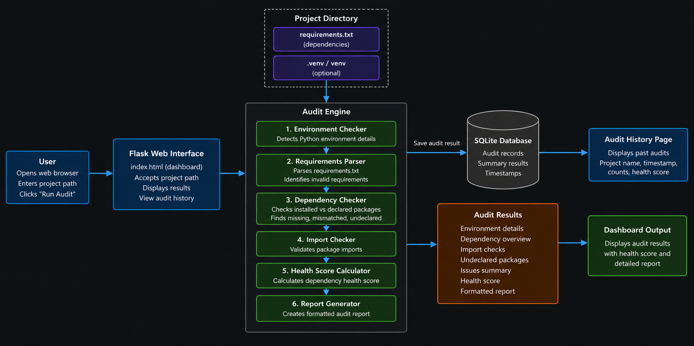
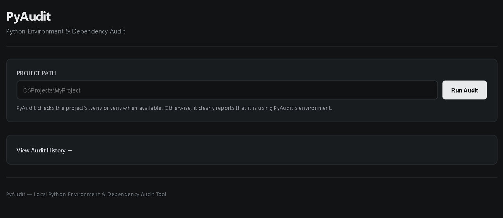
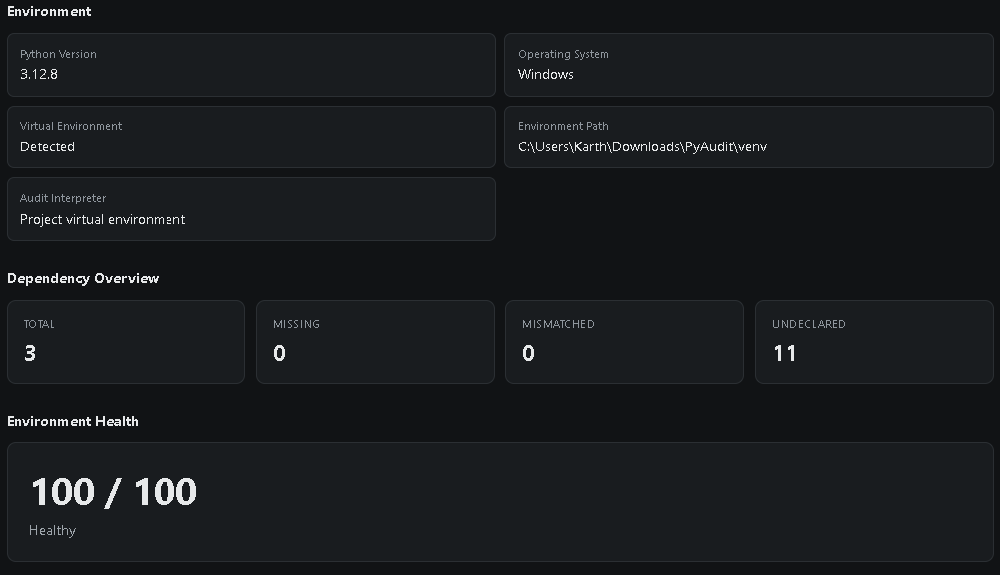
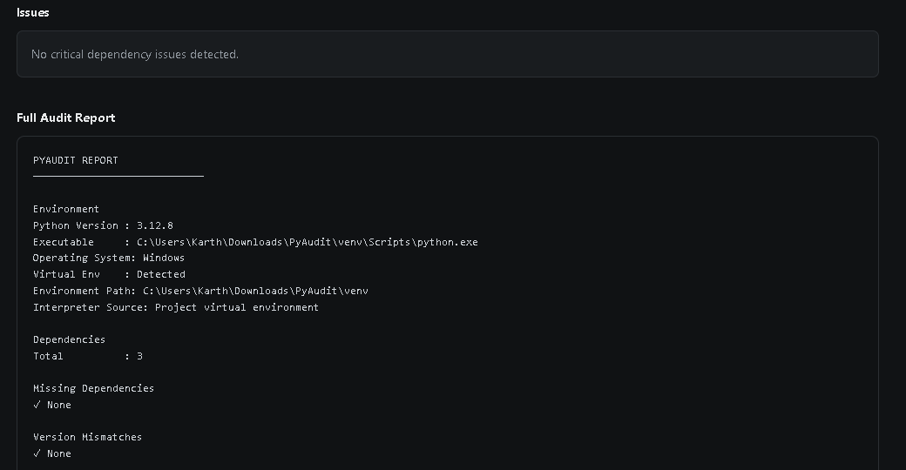
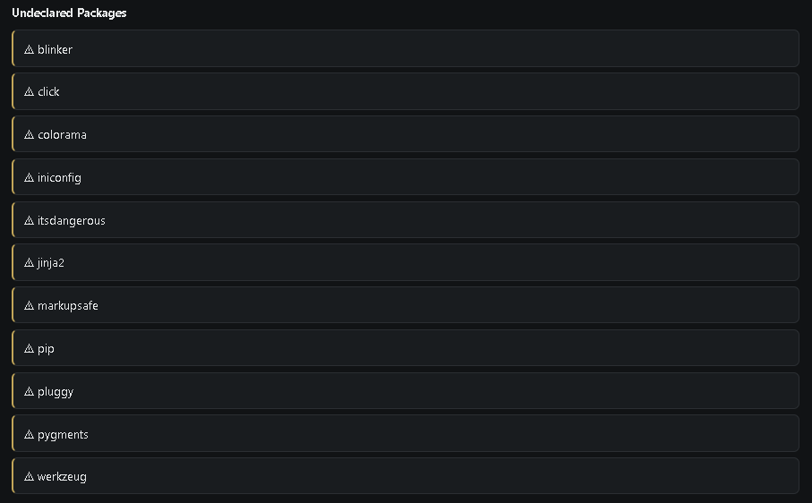
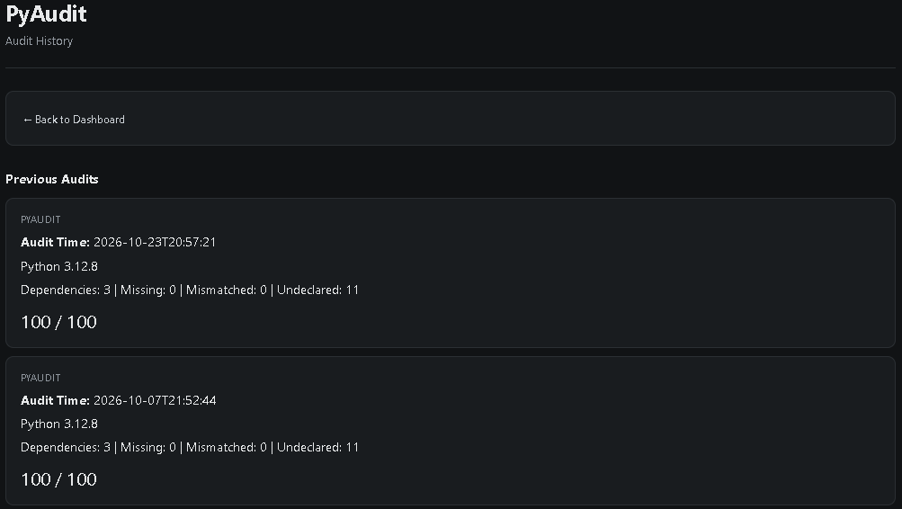

# PyAudit

**Audit your Python environment before it breaks your project.**

PyAudit is a lightweight, local web application for auditing a Python project's declared dependencies against an installed Python environment. It identifies dependency inconsistencies, checks import availability, calculates a dependency health score, generates a readable audit report, and stores audit history in SQLite.

## Features

- **Environment inspection** — Displays Python version, executable path, operating system, and virtual environment information.
- **Dependency detection** — Identifies missing packages, version mismatches, and undeclared installed packages.
- **Requirements parsing** — Reads package requirements from a project's `requirements.txt` and reports invalid requirement entries.
- **Import checks** — Checks whether imports associated with declared package names are available.
- **Health score** — Calculates a score out of 100 based on dependency and import issues.
- **Audit reports** — Generates a readable report containing environment details, dependency checks, and an issue summary.
- **Audit history** — Stores audit summaries locally using SQLite.
- **Web dashboard** — Provides a Flask interface for running audits and reviewing results.
- **Automated tests** — Includes tests for environment inspection, requirements parsing, dependency checks, health scoring, database operations, and web routes.

## Workflow Architecture

The diagram below illustrates PyAudit's workflow, from project path selection and environment inspection to dependency analysis, report generation, and audit history storage.



### Workflow Overview

1. **User Input** — The user enters a project directory through the Flask web interface.
2. **Audit Engine** — Coordinates environment inspection, requirements parsing, dependency checks, import checks, health score calculation, and report generation.
3. **Audit Results** — The application prepares environment details, dependency findings, issue summaries, and the health score.
4. **SQLite Database** — Stores audit summaries and timestamps for historical review.
5. **Dashboard and History** — Displays the current audit results and previously saved audits.


## Screenshots

### 1. Dashboard

The main interface for entering a project path and starting an audit.



### 2. Successful Audit

Displays environment information, dependency results, and the overall health score.



### 3. Issues and Report

Shows dependency checks and the generated audit report.



### 4. Undeclared Packages

Highlights installed packages that are not declared in the project's requirements file.



### 5. Audit History

Displays previously saved audit records, including timestamps, dependency counts, and health scores.



## Technologies

- Python
- Flask
- SQLite
- HTML
- CSS
- JavaScript
- pytest
- packaging

## Requirements

- Python 3.10 or newer
- pip

## Installation and Setup

### 1. Clone the repository

Clone the PyAudit repository from GitHub and navigate to the project directory.

```powershell
git clone <YOUR-PYAUDIT-REPOSITORY-URL>
cd PyAudit
```

Replace the placeholder with your actual repository URL.

### 2. Create a virtual environment

```powershell
py -m venv .venv
```

### 3. Activate the virtual environment

On Windows PowerShell:

```powershell
.\.venv\Scripts\Activate.ps1
```

On macOS or Linux:

```bash
source .venv/bin/activate
```

### 4. Install dependencies

```powershell
python -m pip install -r requirements.txt
```

### 5. Start the application

```powershell
python app.py
```

Open the application in your browser:

[http://127.0.0.1:5000](http://127.0.0.1:5000)

## Usage

1. Start PyAudit using the instructions above.
2. Enter the absolute path to a project directory containing `requirements.txt`.
3. Click **Run Audit**.
4. Review the environment information, dependency checks, import results, and health score.
5. Review the generated audit report.
6. Open **Audit History** to view previously saved audit summaries.

PyAudit is designed to run locally. Audit results and history are stored in the local SQLite database.

## Understanding the Results

| Result | Meaning |
|---|---|
| Missing dependencies | Declared packages that are not installed in the environment being audited. |
| Version mismatches | Installed package versions that do not satisfy their declared version constraints. |
| Undeclared packages | Installed packages that are not listed in the project's parsed requirements. |
| Import checks | Whether the corresponding import names are available. |
| Invalid requirements | Requirement lines that cannot be parsed. |
| Health score | A heuristic score out of 100 that decreases when specified issues are detected. |

A higher health score indicates fewer detected issues. The score is a project-specific indicator, not a security certification or a guarantee that the application will run correctly.

## Running Tests

Run the automated test suite from the project root:

```powershell
python -m pytest
```

The current test suite has **15 passing tests**.

## Project Structure

```text
PyAudit/
├── app.py
├── audit_engine.py
├── environment_checker.py
├── package_checker.py
├── requirements_parser.py
├── dependency_checker.py
├── import_checker.py
├── health_score.py
├── report_generator.py
├── database.py
├── requirements.txt
├── README.md
├── .gitignore
├── templates/
│   ├── index.html
│   └── history.html
├── static/
│   └── style.css
├── screenshots/
│   ├── dashboard.png
│   ├── successful_audit.png
│   ├── issues_and_report.png
│   ├── undeclared_packages.png
│   └── audit_history.png
├── tests/
│   ├── test_environment.py
│   ├── test_packages.py
│   ├── test_requirements.py
│   ├── test_dependencies.py
│   ├── test_audit_engine.py
│   ├── test_database.py
│   └── test_app.py
└── database/
    └── pyaudit.db
```

The local virtual environment and Python cache files are excluded from version control through `.gitignore`.

## Project Summary

**PyAudit — Python Dependency and Environment Auditor**

PyAudit was built to help developers identify dependency inconsistencies before they cause problems in a project. It combines Python environment inspection, requirements parsing, dependency checks, import checks, health scoring, report generation, and persistent audit history in a lightweight Flask application.

## Scope and Limitations

PyAudit is a local portfolio and learning project focused on Python dependency and environment consistency.

- It does not automatically install or update packages.
- It does not perform vulnerability or CVE scanning.
- It does not resolve complete transitive dependency trees.
- Its health score is a heuristic rather than a security or quality certification.
- Requirements syntax and environment-selection behavior are limited to what the current implementation supports.

For security-focused dependency vulnerability scanning, consider dedicated tools such as `pip-audit`.

## Future Improvements

- More comprehensive requirements-file support.
- Clearer project environment selection and validation.
- Additional audit filtering and comparison features.
- Exportable JSON audit reports.
- Improved test coverage for unusual project configurations.
---